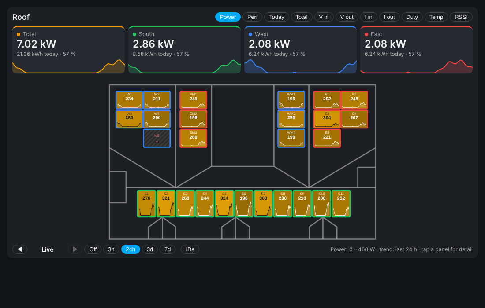
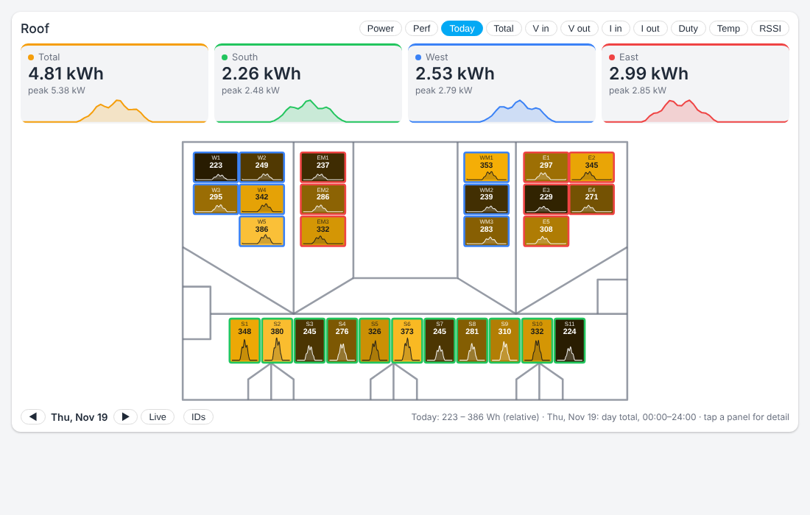
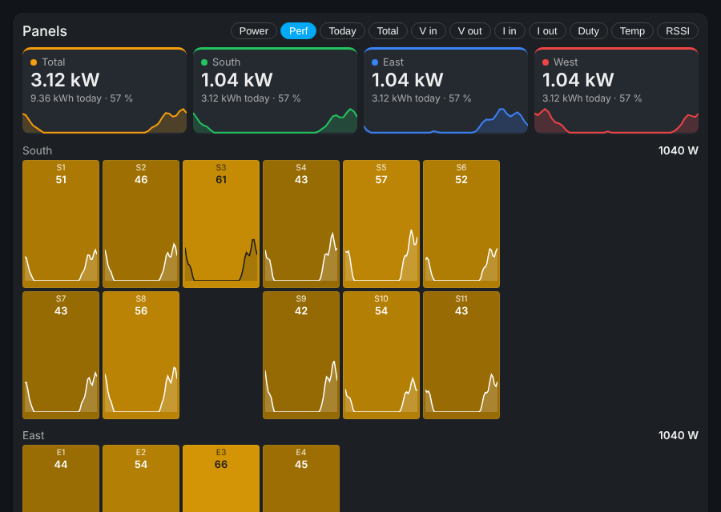
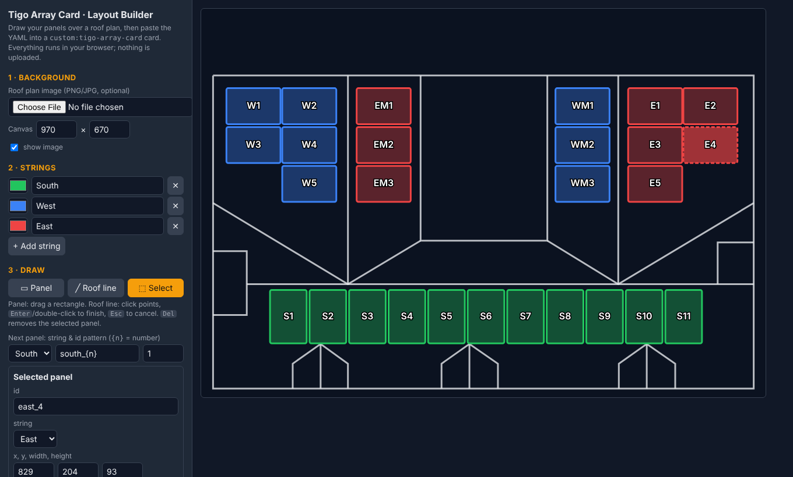

# Tigo Array Card

A Home Assistant dashboard card that draws your **Tigo TS4 optimisers on a plan of your roof**, coloured by live power, performance, energy, voltage, current, temperature or signal strength. Each panel gets its own trend sparkline, and you can step back through previous days to compare them.

It reads the sensors created by the **[PyTap](https://github.com/azebro/pytap)** integration, which listens to the Tigo RS485 bus locally. No Tigo cloud account or API is involved.



[](https://hacs.xyz/docs/faq/custom_repositories)

## Contents

- [Features](#features)
- [What you need](#what-you-need)
- [Installation](#installation)
- [Quick start (grid mode)](#quick-start-grid-mode)
- [Draw your actual roof (drawing mode)](#draw-your-actual-roof-drawing-mode)
- [Options](#options)
- [Using the card](#using-the-card)
- [Troubleshooting](#troubleshooting)
- [More guides](#more-guides)
- [Ideas and contributing](#ideas-and-contributing)

## Features

- **Two layouts.** *Grid mode*: list each string's panels row by row, with no coordinates. *Drawing mode*: an exact roof plan with hips, valleys and dormers, where every panel sits where it really is.
- **11 metrics**, switched with buttons on the card: Power, Performance, Energy today, Total energy, V in, V out, I in, I out, DC-DC duty cycle, Temperature, RSSI.
- **A sparkline in every panel** over 3 h, 24 h, 3 days or 7 days, plus a whole-string trend in the summary tiles.
- **Summary tiles** for the whole installation and each string: power, energy today, performance and trend.
- **Day view**: step back day by day to compare each panel's peak power, daily energy or average.
- **IDs view**: shows every optimiser's barcode in its position, for checking that the layout matches the roof.
- **Dead-panel highlighting**: an optimiser with no data is drawn hatched with a red outline.
- **Layout builder**: draw your panels over a photo or plan of your roof in the browser, and copy the YAML out.
- Follows your Home Assistant theme (light or dark) and works in Sections, Masonry and Panel views.

| Day view (light theme) | Grid mode |
|---|---|
|  |  |

## What you need

1. **Tigo TS4 optimisers with a Tigo CCA and TAP**: the standard Tigo monitoring setup.
2. **An RS485-to-Ethernet adapter** wired to the CCA's RS485 "Gateway" bus, in listen-only mode. A Waveshare RS485 TO POE ETH (B) is a well-tested choice.
3. **The [PyTap](https://github.com/azebro/pytap) integration** in Home Assistant, set up with your optimiser barcodes.
4. **Home Assistant 2024.8 or newer.** Developed and tested on 2026.11.

If you haven't got the hardware and PyTap running yet, start with **[docs/tigo-pytap-setup.md](docs/tigo-pytap-setup.md)**. It covers the adapter settings, wiring, PyTap configuration and the usual first-day problems step by step.

## Installation

### Option A – HACS (recommended)

1. In Home Assistant open **HACS**, then the **⋮** menu (top right) → **Custom repositories**.
2. Repository: `https://github.com/RootCNC/tigo-array-card`. Type: **Dashboard**. Click **Add**.
3. Search HACS for **Tigo Array Card**, open it and click **Download**.
4. Reload the browser (Ctrl+F5). In the phone app: Settings → Companion app → Debugging → *Reset frontend cache*.

HACS registers the card as a dashboard resource for you.

### Option B – manual

1. Download `tigo-array-card.js` from this repository (or from the latest release).
2. Copy it to `/config/www/` on your Home Assistant. The **File editor** or **Samba** add-on is the easiest way. Create the `www` folder if it doesn't exist; if you had to create it, **restart Home Assistant once** so `/local/` starts serving it.
3. Go to **Settings → Dashboards → ⋮ → Resources → Add resource**:
   - URL: `/local/tigo-array-card.js?v=1`
   - Resource type: **JavaScript module**
4. Reload the browser (Ctrl+F5).

> **Updating manually:** replace the file, then bump the number at the end of the resource URL (`?v=2`, `?v=3`, …). Browsers cache the old version otherwise.

To check it loaded, open the browser console (F12). You should see a `TIGO-ARRAY-CARD v1.0.0` banner.

## Quick start (grid mode)

### 1. Find your panel ids

PyTap names each optimiser's sensors after the module name you gave it, e.g. `sensor.tigo_ts4_south_1_power`. The card needs the middle part, **`south_1`**. To list all of yours, paste this into **Settings → Tools (Developer tools) → Template**:

```jinja

{{ e | replace('sensor.tigo_ts4_', '') | replace('_power', '') }}

```

### 2. Add the card

Edit a dashboard, choose **+ Add card → Manual**, and paste the following. Change the ids, rows and `peak` to match your system:

```yaml
type: custom:tigo-array-card
title: Panels
peak: 460            # your panel rating in W
grid_options:
  columns: full
strings:
  - name: South      # must match the PyTap string name, so the totals tile works
    rows:
      - [south_1, south_2, south_3, south_4, south_5, south_6]
      - [south_7, south_8, null, south_9, south_10, south_11]   # null = gap
  - name: East
    rows:
      - [east_1, east_2, east_3, east_4]
```

Arrange the rows roughly as the panels sit on the roof. That's enough to spot a weak panel at a glance.

## Draw your actual roof (drawing mode)

Drawing mode places every panel at exact coordinates over an outline of your roof, as in the screenshot at the top.

### The easy way: the layout builder



1. Download **[tools/layout-builder.html](tools/layout-builder.html)** and open it in any desktop browser. It runs entirely offline and nothing is uploaded.
2. **Background:** load a roof plan, an installer's layout drawing or an aerial screenshot. The canvas takes the image's size.
3. **Strings:** name them **exactly as in PyTap** (e.g. `South`, `East`, `West`) and pick colours.
4. **Panel tool:** choose the string and the id pattern (e.g. `south_{n}`), then drag a rectangle over the first panel. Its id is filled in automatically and the number counts up.
5. **Repeat:** with a panel selected, use *Repeat* to add a whole row or column at the same size and spacing in one go.
6. **Roof line tool** (optional): click each corner along ridges, hips and edges. Finish each line by double-clicking, pressing Enter or clicking **Finish line**.
7. **Select tool:** click a panel to fix its id or string, drag it to nudge it, or press Delete to remove it.
8. **Copy YAML** and paste it into a Manual card.

To change a layout later, open the builder and paste your card's YAML into *Edit an existing layout*. It accepts the YAML exactly as Home Assistant's card editor shows it, a whole dashboard's raw configuration (it finds the card inside), and grid-mode cards (their rows are laid out as a starting point).

### By hand

The format is simple if you'd rather type it:

```yaml
type: custom:tigo-array-card
title: Roof
peak: 460
view_box: "0 0 1000 700"        # the coordinate space: x from 0 to 1000, y from 0 to 700
grid_options:
  columns: full
string_colours:                 # string name -> outline colour of its panels
  South: "#22c55e"
  West: "#3b82f6"
outline:                        # optional roof lines, as SVG path strings
  - "M20 20 H980 V680 H20 Z"    # M = move to x y, H = horizontal line to x, V = vertical line to y, Z = close
  - "M20 400 L500 250 L980 400" # L = straight line to x y
panels:
  - { id: south_1, string: South, at: [100, 480, 60, 90] }   # at: [x, y, width, height] of the panel
  - { id: south_2, string: South, at: [165, 480, 60, 90] }
  - { id: west_1,  string: West,  at: [40, 130, 90, 60] }
```

- `x` and `y` are the panel's **top-left corner**. Use the same units as `view_box`; any scale works, it's the proportions that matter.
- Opening your roof image in any editor that shows pixel coordinates (Paint, GIMP, Photopea) and using the image size as `view_box` makes measuring easy.
- Always use `at: [...]`. Don't write separate `x:`/`y:` keys: some YAML parsers read `y` as "yes".
- A complete real-world example (27 panels on three roof faces) is in **[examples/roof-drawing.yaml](examples/roof-drawing.yaml)**.

### Check the positions

Once the card is showing, press **IDs**. Every panel then shows the barcode of the optimiser PyTap has mapped to it. Compare these with the installer's layout map or the Tigo app. If two are swapped, swap their `id:` values.

## Options

| Option | Default | Description |
|---|---|---|
| `strings` | – | **Grid mode.** List of `{ name, rows }`. Each row is a list of panel ids; `null` leaves a gap. |
| `panels` | – | **Drawing mode.** List of `{ id, string, at: [x, y, w, h] }`. Optional `label` (text shown instead of the short name) and `barcode` (if Home Assistant doesn't expose one). |
| `view_box` | `"0 0 1000 700"` | Drawing mode: coordinate space, `"minX minY width height"`. |
| `outline` | – | Drawing mode: list of SVG path strings for roof lines. |
| `string_colours` | – | Map of string name to colour. In drawing mode this also sets the order of the summary tiles. |
| `title` | `Panels` | Card title. |
| `peak` | `460` | Panel rating in W. Power colours run from 0 to this. |
| `metric` | `power` | Metric selected when the card loads. |
| `metrics` | all 11 | Which metric buttons to show, e.g. `[power, performance, daily_energy, temperature]`. |
| `history_hours` | `24` | Sparkline span when the card loads: `0` (off), `3`, `24`, `72`, `168`. |
| `summary` | `true` | Show the Total and per-string tiles. |
| `max_height` | fits window | Drawing mode: maximum height of the roof drawing (any CSS size such as `60vh`, `500px`, or `none`). |
| `aspect` | `0.6` | Grid mode: panel width ÷ height (`0.6` portrait, `1.65` landscape). |
| `panel_width` | `96` | Grid mode: maximum tile width in px (`0` = stretch to fill). |
| `prefix` | `sensor.tigo_ts4_` | Panel entities are `<prefix><id>_<metric>`. |
| `summary_prefix` | `sensor.tigo_` | Totals are `<summary_prefix>installation_power` and `<summary_prefix>string_<name>_power`. |
| `grid_options` | – | Standard HA option. `columns: full` makes the card fill a Sections layout. |

Metric keys: `power`, `performance`, `daily_energy`, `total_energy`, `voltage_in`, `voltage_out`, `current_in`, `current_out`, `dc_dc_duty_cycle`, `temperature`, `rssi`.

Every option with a comment: [examples/all-options.yaml](examples/all-options.yaml).

## Using the card

- **Metric buttons** (top right) recolour every panel.
  - **Power** is scaled to `peak`; **Perf** and **Duty** run 0–100 %.
  - Everything else is coloured *relative to the other panels*, so the odd one out stands out even on a dull day.
  - **Temp** uses a blue-to-red scale.
- **Off / 3h / 24h / 3d / 7d** set the sparkline span. All panels share one vertical scale, so a shaded panel shows a visibly smaller curve than its neighbours.
- **◀ ▶** step through whole days and **Live** returns to now. In a past day each panel shows that day's peak (power, voltages, currents, temperature), total (energy) or average (duty, RSSI), with a midnight-to-midnight sparkline. Home Assistant keeps 5-minute statistics for about 10 days and hourly ones after that, so older days are a little coarser.
- **IDs** shows each optimiser's barcode in place of its value.
- **Tap a panel or summary tile** to open Home Assistant's history for it.
- **Performance** (on the tiles and the Perf button) is PyTap's figure: current power as a percentage of rated peak. 10–15 % on an overcast winter midday is normal.

### Make it big

- **On its own tab:** add a view with **View type: Panel (single card)** and put just this card in it. It then fills the screen, and is the best way to view a large array.
- **In a Sections dashboard:** keep `grid_options: columns: full`, then edit the section and raise its **Column span**.
- **On a wide, short monitor:** the drawing limits its height to the window by default. Set `max_height: 60vh` (or smaller) to shrink it further.

## Troubleshooting

| Symptom | Fix |
|---|---|
| "Custom element doesn't exist: tigo-array-card" | The resource isn't loaded. Check Settings → Dashboards → Resources, then press Ctrl+F5. On the phone app, reset the frontend cache. |
| Card shows an older version after updating | Bump `?v=` on the resource URL (manual installs), or redownload in HACS, then press Ctrl+F5. |
| Outline draws but no panels appear | Use `at: [x, y, w, h]`, not `x:`/`y:` keys. A red warning line on the card says how many panels have no valid position. |
| Every panel shows "–" | The ids don't match your entities. Run the template in *Find your panel ids* and compare, and check `prefix`. |
| Some panels hatched / "–" | PyTap has no data for that optimiser. See *Panels missing* in [the PyTap guide](docs/tigo-pytap-setup.md#panels-missing-or-intermittent). |
| String tiles show "–" | The string `name` must match the PyTap string name (spaces become `_` in entity ids). |
| Card doesn't fill the section | Add `grid_options: columns: full`, and widen the section's Column span. |
| IDs view shows "?" | Home Assistant doesn't expose the barcode for that device. Add `barcode: "…"` to that panel in the YAML. |
| Sparklines empty | Normal for the first hours after setup, and overnight. The recorder must be keeping history for the `sensor.tigo_ts4_*` entities. |

## More guides

- **[docs/tigo-pytap-setup.md](docs/tigo-pytap-setup.md)**: Waveshare adapter settings, wiring to the CCA, installing and configuring PyTap, reading its diagnostics, adding a second TAP.
- **[docs/foxess-modbus.md](docs/foxess-modbus.md)**: local control of a FoxESS hybrid inverter over RS485 with a second Waveshare adapter, plus the Energy dashboard setup.
- **[docs/dashboard-and-energy-tracking.md](docs/dashboard-and-energy-tracking.md)**: a complete four-tab solar dashboard, Solcast forecast-vs-actual tracking, savings sensors and alerts.
- **[docs/reference-system.md](docs/reference-system.md)**: the installation this card was built on, and how it's wired and configured.
- **[docs/faq.md](docs/faq.md)**: answers to questions that came up while building all of this.

## Ideas and contributing

Issues and pull requests are welcome. See **[docs/roadmap.md](docs/roadmap.md)** for ideas that would make the card better, including a visual editor, underperformance alerts and support for other optimiser brands.

Credit goes to **[PyTap](https://github.com/azebro/pytap)** and the **[taptap](https://github.com/willglynn/taptap)** project, which reverse-engineered the Tigo protocol and made local monitoring possible.

This project isn't affiliated with or endorsed by Tigo Energy. "Tigo" is a trademark of Tigo Energy, Inc.

Licence: [MIT](LICENSE)
