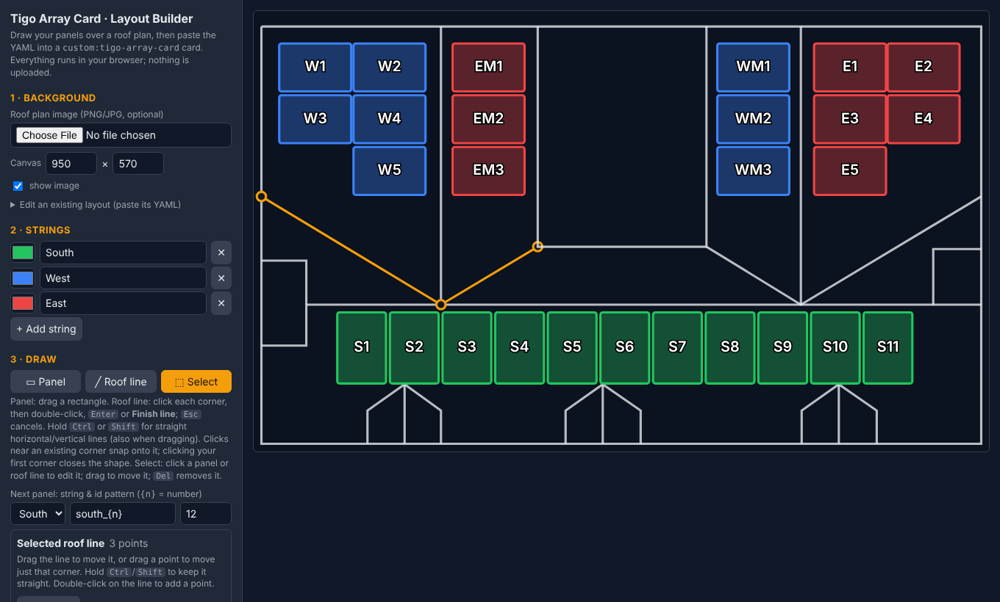

# Layout builder guide

The layout builder lets you draw your panels and roof outline over a picture of your roof, then copy out ready-made YAML for the Tigo Array Card. You don't need to measure a single coordinate.

**Open it:** **https://rootcnc.github.io/tigo-array-card/tools/layout-builder.html**

It runs entirely in your browser. Your roof image and layout never leave your computer. To use it offline, download [`tools/layout-builder.html`](../tools/layout-builder.html) from the repository and double-click it.

Use a desktop or laptop browser (Chrome, Edge, Firefox or Safari) with a mouse or trackpad. It works on a tablet, but precise dragging is much easier with a mouse.



---

## Before you start

1. **Your panel ids.** These are the names PyTap gave your optimisers, as used in the entity ids: `sensor.tigo_ts4_south_1_power` → `south_1`. To list them all, paste this into Home Assistant's **Settings → Tools (Developer tools) → Template**:

   ```jinja
   
   {{ e | replace('sensor.tigo_ts4_', '') | replace('_power', '') }}
   
   ```

2. **Your string names** exactly as entered in PyTap (e.g. `South`, `East`, `West`). The card's per-string tiles use them.

3. **A picture of your roof** (optional, but it makes things much quicker). Good sources:
   - the installer's panel layout drawing or design report;
   - a screenshot of your roof from an aerial map;
   - a simple sketch you've drawn and photographed.

   Crop it to the roof first. A straight-down view works best; the drawing doesn't have to be to scale.

4. **Which optimiser is on which panel**, if you know it (from the installer's barcode map or the Tigo app). If you don't, draw your best guess and check it afterwards with the card's **IDs** button.

---

## Step by step

### 1. Background

- Click **Choose File** under *Background* and pick your roof image. The canvas resizes to match the image, and the image is shown faded so your drawing stands out.
- No image? Set the **Canvas** width × height instead (the default 1000 × 700 is fine) and draw freehand.
- Untick **show image** at any time to see just your drawing.

### 2. Strings

- There are three strings to start with: South (green), West (blue) and East (red). **Rename them to match PyTap exactly**, change the colours with the colour boxes, use **+ Add string** for more, and ✕ to remove one.
- Each panel's outline is drawn in its string's colour, both here and on the card.

### 3. Draw the panels

1. Make sure the **Panel** tool is selected (orange).
2. Under *Next panel*, pick the **string** and check the **id pattern**. Choosing a string fills in a pattern such as `south_{n}`, where `{n}` is replaced by the number in the box next to it. Edit the pattern if your names differ, e.g. `east_middle_0{n}` for `east_middle_01`.
3. **Drag a rectangle** over the first panel in the image. It's given the next id (e.g. `south_1`) and the number counts up, ready for the next one.
4. Keep dragging over each panel in the same string, in order.

**Rows of identical panels.** Draw the first panel carefully, leave it selected, and use **Repeat this panel** in the sidebar. Enter the number of copies, the gap between panels, and the direction (→ ↓ ← ↑), then click **Repeat**. The copies get consecutive ids.

**Switching to the next string.** Pick it under *Next panel*. Numbering carries on from the highest id already used for that string.

### 4. Draw the roof lines (optional)

Roof lines are just for orientation: edges, ridges, hips, valleys, dormers, chimneys.

1. Select the **Roof line** tool.
2. **Click each corner** in turn. A dashed preview follows the mouse, and a bar shows how many points you've placed.
3. **Finish the line** by double-clicking, pressing **Enter**, or clicking **✓ Finish**. **Esc** or **✕ Cancel** abandons it.
4. Hold **Ctrl** or **Shift** while clicking to keep the next segment exactly horizontal or vertical. Release the key for angled lines such as hips.
5. **Clicking near an existing corner snaps onto it exactly**, so hips and valleys join the roof edge cleanly.
6. For a closed outline (like the edge of the roof), click back on your first corner. That closes the shape and finishes the line.

Draw each separate feature as its own line. Switching to another tool part-way through keeps the line you were drawing.

### 5. Fix things up (Select tool)

Select the **Select** tool, then click what you want to change.

**A panel:**
- Its details appear in the sidebar. Change the **id** or **string**, or type exact **x, y, width, height** values.
- **Drag** it to move it. Hold **Ctrl/Shift** to move it in a straight line, which keeps rows aligned.
- **Repeat** it, or **Delete panel**.

**A roof line:**
- It turns orange, with a dot on each corner.
- **Drag the line** to move all of it. **Drag a dot** to move just that corner.
- Hold **Ctrl/Shift** while dragging a corner and it snaps so that segment is exactly horizontal or vertical.
- **Double-click on the line** to add a corner there.
- **Delete** removes the selected corner. With no corner selected, it removes the whole line.

Clicking an empty area clears the selection. **Ctrl+Z** (or **Undo**) undoes the last change, one step per drag.

### 6. Options

- **Title:** shown at the top of the card.
- **Panel peak (W):** your panel rating. Power colours are scaled to it.
- **Snap grid:** rounds every position to this many units. `1` means no snapping; try `5` or `10` for neater numbers.

### 7. Copy it into Home Assistant

1. Click **Copy YAML**. The text box shows exactly what's copied.
2. In Home Assistant, edit your dashboard and add a card (**+ Add card → Manual**), or edit an existing Tigo Array Card and open its code editor. Paste, replacing everything, and save.
3. Press **IDs** on the card and compare the barcodes against your installer's map or the Tigo app. If two panels are swapped, fix their ids in the builder (or directly in the YAML).

The YAML includes `grid_options: columns: full` so the card fills a Sections layout. For the biggest view, put the card on its own dashboard tab with the view type **Panel (single card)**.

---

## Editing a layout later

1. Open the builder and expand **Edit an existing layout (paste its YAML)** under *Background*.
2. Copy your card's YAML from Home Assistant (the card's code editor) and paste it in.
3. Click **Load layout**. You'll see "Loaded 27 panels, 15 roof lines" or similar, or a message saying what's wrong.
4. Make your changes, **Copy YAML**, and paste it back into the card.

The import accepts:

- the card exactly as Home Assistant's editor shows it;
- a whole dashboard's raw configuration (the builder finds the card inside);
- a **grid-mode** card, whose rows are laid out in a grid as a starting point for positioning them properly;
- older layouts written with `x:`/`y:`/`w:`/`h:` instead of `at:`.

To trace over your roof image again, **load the image first**, then the layout. The image is stretched to the layout's canvas, so if the two have different proportions it will look squashed. Panels are still placed correctly.

---

## Mouse and keyboard reference

| Action | How |
|---|---|
| Draw a panel | Panel tool, then drag |
| Add a roof line corner | Roof line tool, then click |
| Finish a line | Double-click, **Enter**, or **✓ Finish** |
| Close a shape | Click its first corner again |
| Join onto an existing corner | Click near it (it snaps) |
| Cancel a line in progress | **Esc** or **✕ Cancel** |
| Straight horizontal/vertical | Hold **Ctrl** or **Shift** (on a Mac, use **Shift**) |
| Select a panel or line | Select tool, then click it |
| Move a panel or whole line | Select tool, then drag it |
| Move one corner of a line | Select the line, then drag its dot |
| Add a corner to a line | Select the line, then double-click on it |
| Delete selected corner / line / panel | **Delete** or **Backspace** |
| Clear the selection | **Esc**, or click empty space |
| Undo | **Ctrl+Z** (⌘Z on a Mac) or **Undo** |

---

## Tips

- **Scale doesn't matter.** The card scales the drawing to fit. Only proportions and relative positions count.
- **Draw panels in the same order as their ids** (e.g. left to right along a row) so the automatic numbering lines up with the real panels.
- **Gaps between panels** make the result easier to read. A few units of gap in *Repeat* looks good on the card.
- **Panels on several roof faces** of one string (like `East_1…5` plus `East_Middle_01…03`) are fine: change the id pattern part-way and carry on.
- **Large photos** work, but cropping to the roof keeps the coordinates small and the YAML tidy.

## Troubleshooting

| Problem | Fix |
|---|---|
| Nothing happens when dragging | Check the right tool is selected (orange). Reload with **Ctrl+F5** in case an old copy of the page is cached. |
| Panels show "–" on the card | Their ids don't match your PyTap entities. Compare them with the template output under *Before you start*. |
| String tiles show "–" | The string names must match PyTap's (spaces become `_` in entity ids). |
| "Couldn't read that YAML" | Copy the whole card from Home Assistant's code editor, including the `type:` line. Pasting it in pieces breaks the indentation. |
| "No tigo-array-card config found" | The pasted text has no `panels:` or `strings:` list. Check you copied the right card. |
| Image looks squashed after loading a layout | Load the image first, then the layout. Placement is still correct either way. |
